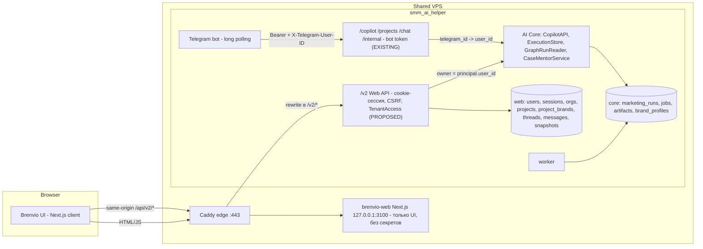
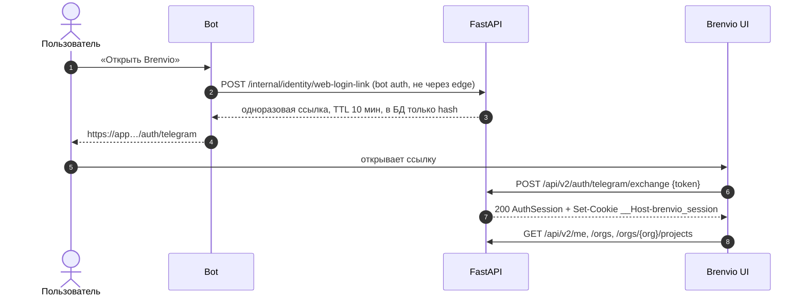
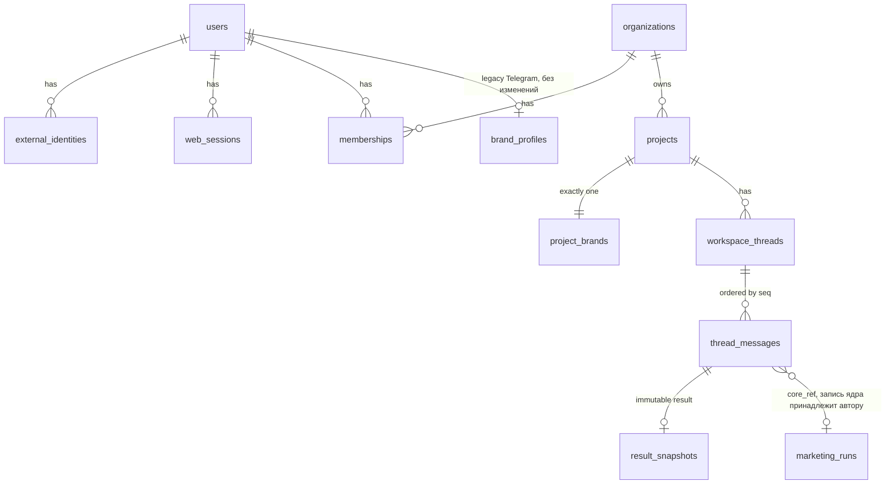

# Brenvio Web API v2 — контракт (C0, черновик)

> **Статус: PROPOSED, `2.0.0-draft.2`.** Ни один маршрут `/v2` в backend сегодня не существует. Этот каталог — только
> документация, OpenAPI, JSON-примеры и docs-only скрипт проверки. Код backend и frontend, миграции, Docker, Caddy,
> CI и production не менялись. Draft.2 — ответ на [ревью PR #8](https://github.com/Pickle-Pee/smm_ai_helper_web/pull/8#issuecomment-6864808422):
> модель snapshot (§11.1), `is_self` вне неизменяемых данных (§11.1), кеширование (§3.1), `ambiguous` и `peek` (§10.3),
> `Retry-After` и квоты (§9.1).
>
> Основание: аудит [#6](https://github.com/Pickle-Pee/smm_ai_helper_web/issues/6)
> ([Addendum 1](https://github.com/Pickle-Pee/smm_ai_helper_web/issues/6#issuecomment-6857772261),
> [Addendum 2](https://github.com/Pickle-Pee/smm_ai_helper_web/issues/6#issuecomment-6858230970),
> [финальное ревью](https://github.com/Pickle-Pee/smm_ai_helper_web/issues/6#issuecomment-6860263535)),
> задача [#7](https://github.com/Pickle-Pee/smm_ai_helper_web/issues/7), эпик
> [smm_ai_helper#158](https://github.com/Pickle-Pee/smm_ai_helper/issues/158).
> База сверки: backend `master` = [`76b6c1b`](https://github.com/Pickle-Pee/smm_ai_helper/tree/76b6c1b),
> frontend `main` = [`4e2d6e3`](https://github.com/Pickle-Pee/smm_ai_helper_web/tree/4e2d6e3).

## 1. Состав

| Файл | Что это |
|---|---|
| [`web-api-v2.openapi.yaml`](web-api-v2.openapi.yaml) | OpenAPI 3.1 (`2.0.0-draft.2`): 28 операций, 106 схем, каталог ошибок (`x-error-catalog`) |
| [`fixtures/`](fixtures/) | 64 JSON-примера: ответы, ошибки, запросы, 4 golden-кейса; реестр — [`fixtures/index.json`](fixtures/index.json) |
| [`decision-register.md`](decision-register.md) | Реестр решений D1–D18, три замечания финального ревью, решения C0 и открытые вопросы |
| [`tools/check_contract.py`](tools/check_contract.py) | Независимая проверка контракта (OpenAPI 3.1, `$ref`, фикстуры, golden-кейсы, кеширование, DTO backend) — §16 |

Метки в спецификации:

| Метка | Где | Значение |
|---|---|---|
| `x-status: existing` | схемы | дословная проекция DTO, существующего в backend `@76b6c1b`; файл-источник — в `x-source`. Здесь не редактируется |
| `x-status: proposed` | операции, схемы | новое в Web API v2; цель внутренней технической беты |
| `x-status: future` | операции, схемы | спроектировано, за feature flag, в бету не входит (веб-чат) |
| `x-status: deferred` | операции, схемы | форма намеренно не зафиксирована (детали legacy-истории) |
| `x-persistence` | схемы | `immutable` — записывается один раз и не меняется; `computed` — вычисляется при каждом чтении; `computed-per-viewer` — зависит от того, кто запрашивает |

Существующие DTO: `BusinessContext`, `MarketSource`, `Confirmation`, `ConfirmationCandidate`, `OwnedSiteResult`,
`Finding`, `SourceSummary`, `Findings`, `Post`, `StrategySection`, `Strategy`, `Experiment`, `Experiments`,
`Calculation*`, `DirectResponse`, `ModuleResponse`, `NeedsInputResponse`, `RunStatus`, `Coverage`, `PublicFailure`,
`RunResponse` ([api_contracts.py](https://github.com/Pickle-Pee/smm_ai_helper/blob/76b6c1b/app/marketing_copilot/api_contracts.py));
`MentorSection`, `MentorExplanation`, `MentorQuestion`, `MentorAnswer`, `MentorTurn`, `MentorHistory`
([mentor_contracts.py](https://github.com/Pickle-Pee/smm_ai_helper/blob/76b6c1b/app/marketing_copilot/mentor_contracts.py)).
Всё остальное — новое.

## 2. Архитектура (C-lite)



- **Next.js** отвечает только за интерфейс. Он не проксирует данные, не хранит токенов и не содержит логики Marketing Copilot.
- **FastAPI `/v2`** владеет сессиями, пользователями, организациями, проектами, брендами, тредами, сообщениями, правами
  доступа, вызовом Copilot/Orchestrator и сохранением результатов.
- **AI Core не меняется по смыслу**: остаётся user-scoped, владелец исполнения — `User.id`. Второго AI backend нет.
- Оба входа (бот и web) сходятся на `User.id` до вызова ядра; ядро не знает, откуда пришёл запрос.

## 3. Маршрутизация через Caddy

| Публичный URL (браузер) | Внутри | Кто обслуживает |
|---|---|---|
| `https://app.<domain>/api/v2/*` | `127.0.0.1:8000/v2/*` | FastAPI Web API v2 |
| `https://app.<domain>/*` (остальное) | `127.0.0.1:3100` | Next.js |
| `/copilot/*`, `/projects/*`, `/chat/*`, `/internal/*` и прочие legacy-пути | — | **наружу не публикуются** |

В OpenAPI пути записаны в нативном виде FastAPI (`/v2/...`), а `servers[0].url = /api`, поэтому публичный адрес
получается как `/api` + `/v2/...`. Нативные и edge-пути не смешиваются.

Предлагаемый блок Caddy (**F4, не входит в C0, не применён**):

```caddyfile
handle /api/v2/* {
	uri strip_prefix /api
	request_body {
		max_size 256KB
	}
	reverse_proxy 127.0.0.1:8000 {
		transport http {
			response_header_timeout 330s
		}
	}
}
```

Требования к маршруту: явный allowlist одного префикса; лимит тела (DTO-бюджет запроса — 128 KiB); таймаут больше
`GRAPH_TIMEOUT_SECONDS` (сейчас 300 с), потому что DIRECT и одиночный модуль выполняются внутри HTTP-запроса.
Ответы edge (413, 502, 504) могут быть не JSON — клиент обрабатывает их как `temporarily_unavailable`.
До F4 требуется подтверждение фактической prod-топологии (OQ-4).

### 3.1 Кеширование и граница edge

Каждый ответ `/v2` — данные тенанта или зависит от сессии, поэтому контракт один для всех:

**`Cache-Control: private, no-store`** — на каждом ответе каждой операции, включая `204`, все ошибки
(`401`, `403`, `404`, `409`, `410`, `422`, `429`, `503`) и ответы `200`/`202` с AI-входами и результатами.
В OpenAPI это `components/headers/CacheControlPrivate` (`const: "private, no-store"`); проверка в
[`tools/check_contract.py`](tools/check_contract.py) падает, если хотя бы у одного ответа заголовка нет.

| Область | Операции |
|---|---|
| Пользователь и сессия | `exchangeTelegramLoginToken`, `getCsrfToken`, `logout`, `getMe` |
| Организации и проекты | `listOrganizations`, `listProjects`, `createProject`, `getProject`, `updateProject` |
| Бренды | `getProjectBrand`, `updateProjectBrand`, `importTelegramBrand` |
| Треды и сообщения | `listThreads`, `createThread`, `getThread`, `removeThread`, `listThreadMessages`, `submitMessage`, `getRequestByKey`, `getMessage` |
| AI-результаты | `getMessageResult` |
| Наставник | `getMentorExplanation`, `createMentorExplanation`, `listMentorQuestions`, `askMentorQuestion` |
| История Telegram | `listTelegramHistory`, `getTelegramHistoryItem` (deferred) |
| Веб-чат (future) | `submitChatMessage` |

Почему `private, no-store`, а не только `no-store`: `no-store` запрещает хранение любому кешу, `private`
дополнительно и явно запрещает общим кешам, если промежуточный узел не поддерживает `no-store`. Публичных,
кешируемых ответов у `/v2` нет. ETag, `Last-Modified` и условные запросы в контракте не используются.

Граница CDN и reverse proxy (требования, **ничего не применено**; действующий Caddy не меняется):

- Единственный путь к API — same-origin `/api/v2/*` через Caddy на том же хосте. CDN перед этим путём в
  архитектуре C-lite не предусмотрен. Если CDN или другой прокси появится перед `app.<domain>`, `/api/*` для
  него — bypass/pass-through: без кеширования, без «cache everything», без игнорирования `Cache-Control`,
  без кеша по ключу без cookie.
- Caddy в стандартной сборке ответы не кеширует; модули HTTP-кеша на маршрут `/api/v2/*` не подключаются.
- Ответы, сгенерированные самим edge (413, 502, 504), не содержат данных тенанта, но в F4 маршрут должен
  гарантировать `Cache-Control: private, no-store` и на них. Точная директива Caddy проверяется в F4
  (`caddy validate` на staging) и в этот PR не входит.
- Next.js не проксирует `/api/v2` и не кеширует его ответы: в клиенте — `fetch(..., {cache: "no-store"})`,
  никакого Service Worker-кеша для `/api/*`. В IndexedDB хранится только незавершённый запрос автора
  (§10, п. 2); при выходе он очищается.
- Smoke-тест F4: каждый ответ `/api/v2/*` (включая 401/404 и edge-ошибки) содержит `private, no-store`, а
  повторный запрос с другой cookie никогда не получает чужое тело.

## 4. Trust boundaries

| Зона | Учётные данные | Доверие | Что запрещено |
|---|---|---|---|
| Браузер | cookie `__Host-brenvio_session` + `X-CSRF-Token` | нулевое: principal определяется только сессией | `BOT_BACKEND_TOKEN`, `X-Telegram-User-ID`, ключи OpenAI, любые сервисные токены — ни в бандле, ни в `NEXT_PUBLIC_*`, ни в запросах |
| Next.js-контейнер | нет | не имеет доступа к данным | хранить секреты, ходить в backend от имени пользователя |
| `/v2` (web trust zone) | сессия | проверяет членство и роль на каждом запросе, без кэша прав | принимать bot-токен; принимать владельца из DTO |
| Legacy-маршруты (bot trust zone) | `BOT_BACKEND_TOKEN` + `X-Telegram-User-ID` | доверенный бот | принимать web-сессию; публиковаться через edge |
| AI Core | вызывается только сервисами backend | владелец = `User.id`, переданный сервером | авторизовать по членству в организации |

Почему нельзя передать bot-токен в браузер: `require_actor`
([security.py](https://github.com/Pickle-Pee/smm_ai_helper/blob/76b6c1b/app/security.py#L25)) доверяет заголовку
`X-Telegram-User-ID`, поэтому токен вместе с *любым* ID даёт доступ к данным *любого* пользователя.

Правила данных, пересекающих границу в браузер:

- Только allowlist-DTO. Поле `debug` из `ChatMessageResponse`, сырой `run.error`, внутренние claim/evidence ID, receipt ID,
  `status_url` ядра и Telegram ID в ответах `/v2` отсутствуют.
- Ошибки не повторяют введённые значения и не содержат свободного текста.
- Чужой и несуществующий ресурс неразличимы (`404 not_found`).

## 5. Аутентификация

### 5.1 Вход через одноразовую ссылку Telegram (internal beta — единственный способ)



- Токен в **фрагменте** URL: не попадает в логи прокси и в `Referer`. Страница сразу убирает его из адресной строки.
- Неизвестный, истёкший и использованный токен неразличимы: `401 login_token_invalid`.
- Сессия создаётся на **тот же `users.id`**, что использует бот: данные не копируются и не сливаются.
- При первом входе создаются personal-организация и personal-проект; legacy-профиль Telegram, если он есть,
  однократно копируется в `project_brands` (см. §8).

Companion-контракт бота (**proposed, вне OpenAPI**: другая trust-зона, в сгенерированный браузерный клиент попадать не должен):

| | |
|---|---|
| Метод и путь | `POST /internal/identity/web-login-link` |
| Аутентификация | существующий `require_actor` (bot token + `X-Telegram-User-ID`); через edge не маршрутизируется |
| Запрос | пустое тело; пользователь — сам actor (ссылку можно получить только для себя) |
| Ответ | `{"url": "https://app.<domain>/auth/telegram#t=<token>", "expires_at": "<RFC 3339>"}` |
| Ошибки | существующие `401`/`503` bot-зоны; rate limit на пользователя |

### 5.2 Сессия и CSRF

- Cookie `__Host-brenvio_session`: случайные 256 бит, `HttpOnly; Secure; SameSite=Lax; Path=/`, без `Domain`.
  В `web_sessions` хранится только `sha256(token)`. Предлагаемые сроки: idle 7 дней, absolute 30 дней (OQ-7).
- На каждом небезопасном методе (`POST`, `PATCH`, `DELETE`) обязательны `X-CSRF-Token` и same-origin
  `Origin` / `Sec-Fetch-Site`. Токен привязан к сессии, выдаётся в `AuthSession.csrf_token` и `GET /v2/auth/csrf`.
  Клиент держит его в памяти; после `403 csrf_failed` запрашивает заново и повторяет запрос.
- CORS отсутствует: API только same-origin.
- `POST /v2/auth/logout` отзывает сессию; идемпотентен. Выход не отменяет выполняющуюся AI-работу.

### 5.3 Что отложено

Email magic link / OTP (`WEB_EMAIL_LOGIN_ENABLED`, B2e), OIDC, привязка Telegram к web-only аккаунту и merge аккаунтов
в спецификацию не входят. Схема данных к ним готова: `users.telegram_id` nullable,
`external_identities.provider ∈ {telegram, email, oidc:*}`. Web-only пользователь никогда не получает вымышленный Telegram ID.

## 6. Модель данных (proposed)



| Таблица | Назначение | Ключевые поля | В API |
|---|---|---|---|
| `users` (existing, меняется только nullable) | единый principal обоих каналов | `id`, `telegram_id` → **nullable** | `User`, `UserRef` |
| `external_identities` | способы входа | `user_id`, `provider`, `subject`, `verified_at`; `UNIQUE(provider, subject)` | `Identity` (без subject) |
| `web_sessions` | браузерные сессии | `user_id`, `token_hash`, `expires_at`, `revoked_at` | `SessionInfo` |
| `organizations` | граница тенанта | `id`, `kind ∈ {personal, team}`, `name`, `deleted_at` | `Organization` |
| `memberships` | членство и роль | `(org_id, user_id)`, `role`, **`version`**, **`revoked_at`** | `OrganizationMembership` (version не отдаётся) |
| `projects` | SaaS-проект; принадлежит организации | `id`, `org_id`, `name`, `status`, `color`, `version`, `deleted_at` | `Project` |
| `project_brands` | **отдельная таблица**, ровно одна строка на проект | `project_id` (PK, FK cascade), `org_id`, поля бренда, `extra_json`, `version`, `updated_by`, `imported_from_brand_profile_id` (без FK), `imported_at` | `ProjectBrand` |
| `workspace_threads` | проектный контейнер запросов | `id`, `org_id`, `project_id`, `created_by`, `kind`, `title`, `last_seq`, слот in-flight, `deleted_at` | `Thread` |
| `thread_messages` | запрос (ревизия) и ответ | `thread_id`, `org_id`, `project_id`, `seq`, `role`, `created_by`, `request_key`, `revision`, принятый запрос, `payload_sha256`, `state`, `core_kind`, `core_ref`; `UNIQUE(thread_id, seq)`, `UNIQUE(created_by, request_key, revision, role)` | `UserMessage`, `AssistantMessage` |
| `result_snapshots` | неизменяемый результат (INSERT-only) | `message_id` (UNIQUE), `org_id`, `project_id`, `envelope_version`, `result_kind`, `schema_version` (сохранённого DTO), `payload`, `payload_sha256`, `writer_version`, provenance: `author_user_id`, `source_kind`, `run_id`, `request_key`, `revision`, `source_completed_at`, `materialized_at`. Ни `is_self`, ни имени автора, ни результата upcasters | `ResultSnapshot.stored`, `.provenance` |

Вспомогательные (в API не видны): `auth_tokens` (одноразовые токены входа), `web_chat_context` (future, B9).

Инварианты:

- `brand_profiles`, `UNIQUE(user_id)`, `User.brand_profile` и `BrandProfileService` **не меняются**; таблицей пользуется только Telegram.
  Web никогда не пишет в `brand_profiles`.
- `marketing_runs`, `jobs`, `orchestration_plans`, `marketing_artifacts`, `conversations`, `messages` не меняются.
- `org_id` / `project_id` денормализованы в сообщениях и snapshots: каждый запрос фильтруется одним условием по тенанту.
  Перенос проекта между организациями не поддерживается.
- Миграции — только expand, от фактического head `master` после стека Codex #174 (D17, OQ-5).

## 7. Роли, владение и безопасность

### 7.1 Кто есть кто

| Вопрос | Ответ контракта |
|---|---|
| **Кто автор AI-запроса** | `principal.user_id` сессии, сохранённый в `thread_messages.created_by`. В DTO нет поля владельца — подставить чужого невозможно |
| **Кто владелец исполнения в ядре** | тот же `User.id`: receipt, graph run, артефакты и mentor-компаньон принадлежат автору (как сегодня) |
| **Кому принадлежит проект** | организации (`projects.org_id`), а не создателю. Уход участника проект не затрагивает |
| **Кто видит результат** | любой активный участник организации проекта (роль `viewer` и выше) — через проектное сообщение и snapshot, а не через запись ядра |
| **Кто запускает новые запросы** | участник с ролью `editor` или `owner`; ядро вызывается только от его собственного имени |
| **Кто отвечает на уточнение, задаёт вопрос наставнику** | только автор запроса |

Совместный доступ возникает **только** в web-слое: `thread_messages.project_id → projects.org_id → memberships`.
Ни один запрос `/v2` не авторизует по `marketing_runs.user_id` коллеги.

### 7.2 Матрица доступа

| Действие | viewer | editor | owner | Не участник |
|---|---|---|---|---|
| Читать проекты, бренд, треды, сообщения, snapshots, объяснение и историю наставника | ✅ | ✅ | ✅ | 404 |
| Создавать и редактировать проект и бренд, создавать тред | 403 | ✅ | ✅ | 404 |
| Отправлять AI-запрос | 403 | ✅ | ✅ | 404 |
| Отвечать на `NEEDS_INPUT`, восстанавливать запрос по `request_key`, создавать объяснение и спрашивать наставника | автор | автор | автор | 404 |
| «Убрать тред из проекта» | 403 | автор треда | ✅ | 404 |
| Импорт Telegram-бренда | — | — | owner **personal**-организации | 404 |
| Личная Telegram-история | только сам пользователь (`/v2/me/telegram-history`) | | | |

Правило кодов: ресурс не виден → `404 not_found`; ресурс виден, но роли или авторства недостаточно → `403 forbidden`.
Addendum 1 предлагал 404 и для второго случая — это вынесено на подтверждение (C0-1).
Во внутренней бете (personal-организация, роль `owner`) `403 forbidden` практически не возникает.

### 7.3 Делегированное чтение и повторная проверка

Незавершённый workflow, открытый другим участником, читается так:

1. `TenantAccess` проверяет членство по web-таблицам и запоминает `membership_version`.
2. Делегированное чтение `GraphRunReader.get_for_owner(owner = message.created_by, run_id = message.core_ref)`:
   owner-фильтр ридера сохраняется, владелец берётся из проверенной проектной привязки, а не из запроса.
3. **Повторная проверка** `membership_version` и `revoked_at IS NULL` непосредственно перед формированием ответа.
   Если членство изменилось — payload отбрасывается, ответ `404`.

Формулировка гарантии (замечание 2 финального ревью): *доступ проверяется непосредственно перед формированием ответа;
все последующие запросы отклоняются.* Это **не** линеаризуемая гарантия: отзыв, зафиксированный после шага 3, может
совпасть по времени с доставкой этого одного ответа. Строгая атомарность потребовала бы отдельного протокола блокировок,
которого в контракте нет.

Receipt ядра (`ExecutionStore.get`) читается только для автора: он не является проектным материалом.
Для остальных участников до материализации показывается состояние с `next_action: wait_for_author`.

### 7.4 Отзыв доступа

- Отзыв или понижение роли увеличивает `memberships.version`; прав никто не кэширует, поэтому следующий запрос получает 404/403.
- Понижение `editor → viewer` до claim ядра: запрос отклоняется, ядро не вызывается.
- Отзыв после claim: run продолжается и остаётся записью ядра автора; бывший участник через проект его не видит.
- Материалы, созданные бывшим участником в проекте, остаются проектными.
- Повторное приглашение создаёт новый `membership_version`.

Тесты O-T1…O-T5 и T1…T10 из аудита сохраняются, с реалистичными утверждениями о конкурентности.

### 7.5 Почему Telegram-история остаётся личной

Она создана пользователем лично, вне какой-либо организации, и содержит его переписку с ботом. Поэтому:
единственная точка доступа — `/v2/me/telegram-history`, только для самого пользователя и только при наличии
Telegram-identity; параметров организации или проекта у неё нет; в org-эндпоинтах она не появляется ни для владельца,
ни для коллег. Поштучный импорт элемента в проект — явное будущее действие владельца (B11), в C0 не входит.

### 7.6 Примеры ошибок доступа

| Ситуация | Ответ | Фикстура |
|---|---|---|
| Проект другой организации | `404 not_found` | [`errors/not-found-foreign-project.404.json`](fixtures/errors/not-found-foreign-project.404.json) |
| Тред другой организации | `404 not_found` | [`errors/not-found-foreign-thread.404.json`](fixtures/errors/not-found-foreign-thread.404.json) |
| Попытка получить чужой AI-run (через сообщение или `request_key`) | `404 not_found` | [`errors/not-found-foreign-run.404.json`](fixtures/errors/not-found-foreign-run.404.json) |
| viewer отправляет запрос | `403 forbidden`, ядро не вызвано | [`errors/forbidden.403.json`](fixtures/errors/forbidden.403.json) |

Три тела `404` идентичны с точностью до `request_id` — и идентичны ответу на несуществующий id.
`run_id` ядра не является адресом в `/v2`: эндпоинта, принимающего его, нет.

## 8. Бренд проекта и Telegram BrandProfile

- `ProjectBrand` повторяет имена и типы полей `BrandProfile` (`brand_name`, `product_description`, `audience`, `tone`,
  `goals`, `channels`), поэтому существующие чистые функции `to_context` и `brand_entries` работают через адаптер без правок ядра.
- `extra` — allowlist. Часть ключей (`customer_job_or_need`, `relevant_alternative`, `product_truth`, `existing_proof`,
  `geography`, `economics`) существующий `brand_entries`
  ([http_context.py](https://github.com/Pickle-Pee/smm_ai_helper/blob/76b6c1b/app/marketing_copilot/http_context.py#L36))
  уже передаёт в ядро как brand-слой; `industry`, `usp`, `competitors` — описательные поля UI, в модель сегодня не попадают.
- **Импорт — копирование, а не синхронизация.** `POST /v2/projects/{id}/brand/import-telegram` копирует личный legacy-профиль
  в personal-проект с provenance `imported_from`. После этого записи независимы: правки в боте не появляются в web-проекте,
  правки в web никогда не пишутся в Telegram. В UI это должно быть сказано прямо: единое AI-ядро не означает единого хранилища бренда.
- **Открытый продуктовый вопрос (OQ-1):** ручная повторная синхронизация («импортировать снова») не согласована.
  До решения повторный импорт закрыт флагом `WEB_BRAND_REIMPORT_ENABLED` (`403 feature_disabled`),
  а `permissions.can_import_telegram_brand` становится `false` после первого импорта.

## 9. Обработка ошибок

Единственное тело ошибки — `ErrorResponse`: `schema_version`, `kind: "ERROR"`, `code`, `request_id`,
опционально `retry_after_seconds` и `owned_site`. Текст показывает UI по `code`. Полный каталог с HTTP-статусом и
политикой повтора — `x-error-catalog` в спецификации; у каждой операции перечислены её коды (`x-error-codes`).

| HTTP | Коды | Что делает клиент |
|---|---|---|
| 401 | `unauthenticated`, `login_token_invalid` | экран входа |
| 403 | `csrf_failed`, `forbidden`, `feature_disabled` | новый CSRF-токен и повтор / показать причину |
| 404 | `not_found`, `mentor_explanation_missing` | «не найдено» |
| 409 | `request_conflict`, `revision_conflict`, `thread_busy`, `stale_project`, `idempotency_conflict`, `confirmation_changed`, `confirmation_unavailable`, `telegram_identity_required`, `import_source_missing`, `mentor_not_applicable`, `result_not_ready`, `result_format_unsupported`, `stale_thread` (future) | по коду, без автоматического повтора (кроме `thread_busy`, `result_not_ready`) |
| 410 | `result_gone` | «результат недоступен»; новый запрос — только по явному действию |
| 413 / 422 | `payload_too_large`, `invalid_request`, `invalid_confirmation` | исправить запрос |
| 429 | `rate_limited`, `quota_exceeded` | см. §9.1; лимиты проверяются **до** записи сообщения и обращения к ядру |
| 503 | `temporarily_unavailable`, `result_corrupted`, `result_unreadable` | восстановление по ключу / сообщение о сбое |

Все ответы, включая ошибки, приходят с `Cache-Control: private, no-store` (§3.1).

### 9.1 Rate limiting и квоты

| | `rate_limited` | `quota_exceeded` |
|---|---|---|
| Что это | короткое окно (секунды–минуты) на пользователя и маршрут | суточный лимит генераций пользователя или организации |
| Когда проверяется | до записи сообщения, claim ядра и вызова модели: ничего не сохранено и не принято | так же |
| `Retry-After` | всегда; delta-seconds, обычно секунды–минуты | всегда; секунды до `quota.resets_at`, **может быть больше 3600** (до суток и более) |
| Тело | `retry_after_seconds` | `retry_after_seconds` + `quota: {scope: user\|organization, window: day, resets_at}` |
| Политика повтора (`x-error-catalog`) | `after_delay`: клиент может один раз автоматически повторить **тот же** запрос с тем же ключом после `Retry-After`; второй подряд `429` — показать пользователю | `after_reset`: **никогда** автоматически; UI показывает время сброса из `quota.resets_at` |
| Ключ | тот же | ничего не было принято, поэтому позже пользователь явно отправляет тот же или новый запрос; генерации ещё не было, дубля быть не может |

Верхней границы у `Retry-After` и `retry_after_seconds` нет (было 3600 — противоречило суточным квотам).
Клиент не вычисляет время сам. Числовые лимиты и граница суток (фиксированные UTC-сутки или скользящие 24 ч)
остаются открытым решением OQ-6; контракт от них не зависит, потому что авторитетен `resets_at`.

Существующие коды ядра сохраняют смысл: `request_conflict`, `confirmation_changed`, `confirmation_unavailable`,
`invalid_confirmation`, `invalid_request`, `not_found`, `temporarily_unavailable`. Не выходят на `/v2`:
`stale_context` (контекст Telegram-чата; web всегда передаёт `context_version = None`) и `execution_invalid`
(после него receipt ядра становится `ambiguous`, что `/v2` показывает как состояние, а не ошибку).

## 10. Идемпотентность и восстановление

Цель: обновление страницы, двойной клик, вторая вкладка и обрыв сети **не вызывают** повторной генерации.
Exactly-once для внешней модели **не обещается**.

1. **Генерация `request_key` на клиенте.** `w-` + UUIDv7 (`^w-<uuid v7>$`). Префикс отделяет web-ключи от ключей бота
   (`tg:<actor>:<chat>:<message>`); ключ удовлетворяет существующему паттерну ядра и живёт в пространстве автора.
   Ключи не переиспользуются никогда, в том числе после истечения receipt.
2. **Сохранение до отправки.** До `POST` клиент записывает в IndexedDB `{thread_id, request_key, revision, payload}`.
   Запись удаляется только после получения долговременного состояния.
3. **Повтор после сетевой ошибки.** Обрыв, таймаут, 502/504 или `503`: клиент вызывает
   `GET /v2/threads/{thread_id}/requests/{request_key}`.
   `404` — нет доступной web-записи; это **не доказательство**, что AI ранее не запускался (строка могла
   быть удалена). Автоматической повторной отправки нет: для безопасного приёма нужна проверка серверного
   срока и отсутствие долговременного tombstone данного ключа. Старые локальные записи IndexedDB сами
   по себе не дают права запускать модель.
   `200` — следовать `next_action`. Повторный `POST` разрешён **только при** `next_action: resubmit_same_key`,
   выданном сервером после проверки безопасного окна восстановления (§10.4), либо для надёжно сохранённого
   receipt/снимка с известной идемпотентностью. Отсутствующий receipt после 30 дней не даёт права повторять модель.
4. **`NEEDS_INPUT`: ключ сохраняется, ревизия меняется.** Ответ на уточнение — тот же `request_key`, `revision + 1`,
   тот же `message`, дополненный payload (контекст, подтверждение). Это существующий контракт ядра: только receipt
   в состоянии `needs_input` принимает изменённый payload
   ([execution_store.py](https://github.com/Pickle-Pee/smm_ai_helper/blob/76b6c1b/app/marketing_copilot/execution_store.py#L95)).
   Ядро при этом **перезаписывает** receipt, поэтому snapshot вопроса создаётся web-слоем сразу.
   Каждая ревизия — отдельная пара сообщений; `is_latest_revision` показывает актуальную.
5. **`409 request_conflict`.** Тот же ключ и ревизия с другим payload либо ключ, использованный в другом треде.
   Клиент payload под ключом не меняет; UI сообщает, что запрос уже отправлен в другом виде. Новая задача — новый ключ.
   `409 revision_conflict` — ревизия не следующая за `needs_input` или изменён `message`.
6. **`503` и неизвестный результат.** `503 temporarily_unavailable` означает «исход пока не определён», а не «ничего не
   произошло»: клиент восстанавливается по ключу (п. 3) и **не создаёт новый ключ** — ни автоматически, ни по кнопке
   «Повторить». `ambiguous` (HTTP 200) — только когда **само ядро** записало неизвестный исход в receipt (§10.3);
   по времени, зависанию или отсутствию ответа он не выводится никогда. Автоповтора нет. Единственный путь к новому
   ключу — явное действие «Начать новый запрос» с предупреждением, что генерация может повториться.
7. **Polling асинхронных задач.** `202` + `state: running` → `GET /v2/messages/{id}` с интервалом `poll_after_ms`
   (2 с → 5 с → 10 с), пока `next_action == "poll"`. SSE и стриминга нет. После перезагрузки или с другого устройства
   клиент находит выполняющийся запрос через `Thread.in_flight`.
8. **Сохранение окончательного результата.** Терминальное состояние ядра материализуется в неизменяемый snapshot
   идемпотентной вставкой: синхронные результаты — в ответе `POST`, workflow — при первом чтении после завершения и фоновым
   sweeper в API-процессе. Транзакции web и ядра не объединяются; во время вызова модели транзакции не удерживаются.
9. **Открытие старого треда после удаления receipt.** `GET /v2/threads/{id}/messages` читает только web-таблицы и snapshots.
   Receipt ядра удаляется через 30 дней — на историю это не влияет. Если snapshot создать не успели, состояние `expired`;
   результат **не регенерируется**.

### 10.1 Состояния и действия

| `state` | Откуда | Snapshot | `next_action` автора |
|---|---|---|---|
| `pending` | сообщение сохранено, receipt ядра отсутствует, а его возраст **строго меньше 7 дней** (§10.4) | нет | `resubmit_same_key` |
| `running` | ядро сообщает receipt или граф как выполняющийся; сколько бы это ни длилось | нет | `poll` |
| `needs_input` | `NEEDS_INPUT` | `NEEDS_INPUT` | `answer_clarification` |
| `completed` | `DIRECT_RESULT`, `MODULE_RESULT`, run `COMPLETED` | да | `none` |
| `completed_with_limitations` | run `COMPLETED_WITH_LIMITATIONS` | `RUN` | `none` |
| `blocked` / `failed` | run `BLOCKED` / `FAILED` | `RUN` с `PublicFailure` | `start_new_request` |
| `ambiguous` | **ядро записало** receipt `ambiguous` (`finish` без ответа) | нет | `start_new_request` |
| `expired` | после безопасного окна receipt отсутствует и нет snapshot; прежнее выполнение могло состояться, но подтверждения уже нет | нет | `start_new_request` |
| `unsupported` | ядро вернуло `CONVERSATION`, веб-чат выключен | `UNSUPPORTED` | `none` |

`next_action` вычисляет сервер; клиент не воспроизводит автомат состояний. Не-автор вместо действий автора получает
`wait_for_author`.

Шесть пользовательских статусов и как они передаются:

| Статус в UI | На проводе | Автоматические действия клиента |
|---|---|---|
| Выполняется | `200`/`202`, `state: running`, `running_overdue: false` | polling по `poll_after_ms` |
| Выполняется дольше обычного — «результат пока не определён» | `200`, `state: running`, `running_overdue: true` | polling реже; можно предложить явное «Начать новый запрос» с предупреждением |
| Готово | `state: completed` / `completed_with_limitations` | нет |
| Нужно уточнение | `state: needs_input` | нет; автор отвечает ревизией + 1 |
| Исход неизвестен (ambiguous) | `state: ambiguous` | нет; только явное «Начать новый запрос» |
| Истёк | `state: expired` | нет |
| Статус временно недоступен | `503 temporarily_unavailable` + `Retry-After`, состояние не меняется | повторное **чтение** по тому же ключу; не отправка |

`running_overdue` — подсказка UI, а не состояние: сервер не меняет `state`, не вызывает модель и не создаёт ключ.
Окно: для синхронных вызовов — `GRAPH_TIMEOUT_SECONDS` плюс запас; точное значение — реализационная деталь B5.

### 10.2 Точки отказа

| Где сбой | Что в БД | Восстановление без повторного вызова модели |
|---|---|---|
| до записи сообщения | ничего | `getRequestByKey` → 404 → тот же запрос тем же ключом |
| между записью сообщения и claim ядра | `pending`, receipt нет | `next_action: resubmit_same_key`; одну генерацию гарантирует claim ядра |
| между claim и завершением | receipt `running` | `running` → polling |
| ядро завершилось, snapshot не записан | receipt `completed` / `needs_input` | чтение автором: replay из `ExecutionStore.get` без модели → идемпотентная материализация |
| ядро зафиксировало `ambiguous` | receipt `ambiguous` | `peek` → состояние `ambiguous`; новый ключ только по явному действию |
| процесс упал, держа claim | receipt `running` навсегда (ядро не переисполняет) | `running` + `running_overdue: true`; **не** `ambiguous`; новый ключ только по явному действию |
| `peek` недоступен / ошибка БД | без изменений | `503 temporarily_unavailable`, повторное чтение тем же ключом |
| workflow терминален, snapshot нет | run терминален | ленивая материализация при чтении + sweeper |
| receipt удалён (30 дней) до материализации; web-сообщение всё ещё `pending` | `peek=None`, возраст сообщения больше окна безопасности | `expired` (`recovery_window_elapsed`), без повторной генерации; graph runs не истекают |
| двойной клик, две вкладки | — | уникальность `(created_by, request_key, revision, role)` + claim ядра; второй ответ — replay |
| другой запрос в том же треде | слот треда занят | `409 thread_busy` |

### 10.3 Read-only проверка состояния Copilot receipt (`ExecutionStore.peek`)

Через публичные методы `ExecutionStore` сегодня состояния `running` и `ambiguous` неразличимы: `get` отвечает
`ProviderUnavailable` (503) на оба. Вывод по времени **исключён** из контракта (было альтернативой в draft.1): зависший
или долгий запрос не доказывает, что receipt записан как `ambiguous`. Контракт требует от ядра одного аддитивного
метода (proposed, по согласованию с Codex, OQ-9):

```python
async def peek(self, owner: int, key: str) -> Literal["running", "completed", "needs_input", "ambiguous"] | None
```

| Свойство | Требование |
|---|---|
| Запрос | один `SELECT` строки `identity(owner, key)` с теми же фильтрами, что у `get`: `user_id == owner`, `workflow_type == copilot_execution.v1`, `created_at` в пределах 30 дней |
| Результат | `row.status` либо `None` (нет строки, чужой владелец, другой тип, истёк retention) |
| Побочные эффекты | **нет**: без `FOR UPDATE`, без `DELETE` по retention, без claim, без проверки fingerprint, без replay, без вызова модели |
| Кто вызывает | только web-слой для автора (`owner = principal.user_id`); другим участникам receipt не читается |
| Telegram | поведение `claim`/`finish`/`get` не меняется; существующие тесты без изменений |

Порядок чтения (`getRequestByKey`, `getMessage` автором) для ревизии без snapshot:

1. `peek(owner, key)`; исключение или метод не развёрнут → `503 temporarily_unavailable`, состояние в БД не меняется.
2. `completed` / `needs_input` → существующий `get` (replay без модели) → идемпотентная вставка snapshot
   (`INSERT … ON CONFLICT (message_id) DO NOTHING` + перевод состояния в одной web-транзакции).
3. `running` → `state: running`; `running_overdue` вычисляется по возрасту только как подсказка.
4. `ambiguous` → `state: ambiguous` (единственный путь к этому состоянию).
5. `None` **не доказывает**, что запрос не выполнялся: это также результат уже удалённого по TTL receipt.
   Только если web-сообщение `pending`, его неизменяемый серверный `created_at` **строго моложе 7 дней**,
   и отсутствие receipt проверено успешным `peek`, возвращаем `pending` + `resubmit_same_key`.
   В остальных случаях отсутствия receipt у старого `pending`-сообщения возвращаем `expired`
   (`recovery_window_elapsed`, `next_action: start_new_request`) без вызова модели. Для прежнего `running`
   без receipt в пределах окна безопасности — `503` и проверка оператором; после окна — закрытие ключа
   без повторной генерации. Сам возраст не считается доказательством статуса `ambiguous`.
6. Повторная проверка членства перед ответом (§7.3).

Откат и восстановление: сбой на шаге 2 откатывает web-транзакцию целиком — receipt ядра не тронут, следующее
чтение повторяет ту же идемпотентную вставку. Если `peek` придётся отозвать, `/v2` деградирует к
`503 temporarily_unavailable` для неопределённых состояний — никогда к `ambiguous`, к повторному вызову модели
или к новому `request_key`.

### 10.4 Безопасное окно повторной отправки `pending` (P1 — защита от повторной генерации)

`ExecutionStore.peek(owner, key) = None` означает как «receipt не создавался», так и «receipt был выполнен,
но удалён по сроку хранения». Поэтому **отсутствие receipt само по себе не разрешает retry**. Источник времени —
неизменяемый серверный `thread_messages.created_at`, созданный и зафиксированный до возможного claim ядра.

Инварианты для реализации B5/B6:

1. `CORE_RECEIPT_RETENTION = 30 дней` — текущая гарантия ядра; более раннее удаление должно блокировать web-retry.
2. `SAFE_PENDING_RETRY_MAX_AGE = 7 дней` — консервативная фиксированная граница, значительно меньше TTL ядра.
   Она **не продлевается** при повторном чтении, обновлении сообщения и повторном `POST`.
3. Только при `web.state=pending`, `peek` успешно вернул `None` **и** `0 ≤ now_utc - created_at < 7 дней`
   можно выдать `next_action=resubmit_same_key`. На сервере `POST` обязан повторно проверить те же
   условия транзакционно перед core claim: старый сохранённый payload сам по себе не является правом на выполнение.
   Для `GET 404` (в том числе после удаления web-строк) автоматическая повторная отправка запрещена;
   сохраняемые tombstones ключей предотвращают повторную генерацию после удаления треда или snapshot.
4. Если окно закончилось, а `peek=None` и snapshot нет, состояние `expired` с
   `state_reason=recovery_window_elapsed`. Это **не доказательство**, что модель не была вызвана:
   результат мог быть создан до удаления receipt. Никаких автоматических вызовов ядра и нового ключа.
   Новый запрос — только явное действие пользователя с предупреждением о возможной повторной оплате.
5. Если `peek` недоступен, нет надёжной timestamp/retention-гарантии либо состояние противоречиво,
   ответ `503 temporarily_unavailable` без смены состояния и без допуска к повторному исполнению.

Регрессионный пример: [`fixtures/golden/pending-receipt-purged.json`](fixtures/golden/pending-receipt-purged.json)
сравнивает свежий `pending` (несколько минут, `peek=None`, безопасная отправка тем же ключом) и старый
`pending` (31 день, когда receipt мог быть завершён и удалён; `expired`, повторного вызова модели нет).

## 11. Долговременное хранение

Receipt ядра хранится 30 дней и активно удаляется; историей он быть не может. Долговременная история — неизменяемые snapshots.

### 11.1 Три части результата: хранимое, представление, проекция зрителя

Ответ `ResultSnapshot` соединяет данные с разным временем жизни. Draft.1 смешивал их (`payload_sha256` описывал
хранимый payload, а `payload` в том же конверте — уже представление); draft.2 разделяет явно:

| Часть ответа | Откуда | Меняется? | Хэшируется? | Одинакова для всех зрителей? |
|---|---|---|---|---|
| `stored` — `schema_version`, `payload_sha256`, `writer_version` | строка `result_snapshots` | никогда (INSERT-only) | `payload_sha256` — от **хранимого** payload | да |
| `provenance` — `source_kind`, `run_id`, `request_key`, `revision`, **`author_user_id`**, `source_completed_at`, `materialized_at` | та же строка | никогда (INSERT-only) | нет: защищено правилом INSERT-only, а не хэшем | да |
| `presentation` — `schema_version`, `decoder`, `upcasters`, `payload` | вычисляется при каждом чтении из хранимого payload | при выпуске новой версии представления | нет | да |
| `author` — `UserRef` (`id`, `display_name`, `is_self`) | вычисляется для текущего пользователя | `display_name` — текущее имя, `is_self` — относительно зрителя | нет | **нет** |

Гарантии контракта:

1. **Хэш — от исходного сохранённого payload.** `stored.payload_sha256 = sha256(canonical(хранимый payload))`,
   вычисляется один раз при записи и проверяется сервером на каждом чтении по хранимой строке **до** декодера.
2. **Upcaster не изменяет сохранённые данные.** Декодер и upcasters работают с копией; ничего не записывается обратно,
   ленивой миграции строк нет, строка с `copilot_api.v1` остаётся `copilot_api.v1` навсегда.
3. **Версия сохранённого DTO известна** — `stored.schema_version` (паттерн `<контракт>.v<n>`, не enum: набор растёт).
4. **Версия возвращаемого представления известна** — `presentation.schema_version` (`const` в схеме каждого
   `result_kind`; сегодня `copilot_api.v1` для всех Copilot-видов). Новая версия представления — изменение этого
   документа и перегенерация типов клиента, а не миграция данных.
5. **Нет ложного `result_corrupted`.** Если `presentation.upcasters` пуст, `presentation.payload` — хранимый payload
   дословно, и `sha256(canonical(presentation.payload)) == stored.payload_sha256` (клиент может это проверить).
   После непустой цепочки хэши расходятся по построению: это не повреждение, клиент хэш не проверяет, а сервер
   проверяет его по хранимой строке. Golden-пример — [`golden/snapshot-upcast-v1-to-v2.json`](fixtures/golden/snapshot-upcast-v1-to-v2.json).
6. **В неизменяемых данных нет данных, зависящих от зрителя.** Автор хранится как `users.id`
   (`author_user_id`); `is_self` и `display_name` вычисляются при ответе. Два участника видят один и тот же
   snapshot с разным `author.is_self` — [`golden/snapshot-two-viewers.json`](fixtures/golden/snapshot-two-viewers.json).
   То же правило для всех `UserRef` в API (`Project.created_by`, `Thread.created_by`, `UserMessage.author`, …):
   это проекции, а не хранимые значения.

Канонический JSON (совпадает с существующим `canonical()` в
[serialization.py](https://github.com/Pickle-Pee/smm_ai_helper/blob/76b6c1b/app/orchestration_runtime/serialization.py#L51)):
`json.dumps(value, ensure_ascii=False, sort_keys=True, separators=(",", ":"), allow_nan=False)` → UTF-8 → `sha256` → hex.
Хранимый payload — результат `model_dump(mode="json")` DTO ядра; DTO `copilot_api.v1` не содержат float
(десятичные значения — строки), поэтому канонический вид воспроизводим из колонки `jsonb`.

### 11.2 Путь чтения: целостность отдельно от совместимости

| Шаг | Проверка | При сбое | Код | `result_status` |
|---|---|---|---|---|
| 1. Целостность | `sha256(canonical(хранимый payload)) == stored.payload_sha256` | **повреждение данных**: алерт, карантин, не регенерировать; декодер не запускается | `503 result_corrupted` | `corrupted` |
| 2. Формат | найти декодер по `(stored.schema_version, result_kind)` | **несовместимость формата**, данные целы | `409 result_format_unsupported` | `format_unsupported` |
| 3. Декодер и upcasters | замороженный декодер + цепочка `v1 → v2 → …` на копии | **дефект кода**, данные не трогаются | `503 result_unreadable` | `unreadable` |
| 4. Проекция зрителя | `author` из `provenance.author_user_id` | — | — | — |

- **Версионированные декодеры** — замороженные копии DTO на момент версии (например,
  `app/saas/history/contracts/copilot_api_v1.py`); после выпуска не редактируются. Старый snapshot никогда не
  валидируется живым DTO: изменение лимита или enum в `copilot_api.v1` иначе сделало бы корректные данные «невалидными».
- **Upcasters** — чистые функции `<from>-><to>/<result_kind>` до версии представления; применённая цепочка видна в
  `presentation.upcasters`, декодер — в `presentation.decoder`.
- **Drift-тест** в web-слое: JSON Schema живого `copilot_api.v1` сравнивается с закреплённым хэшем замороженной копии.
  Падение означает: ввести новую `schema_version`, upcaster и фикстуры. PR Codex он не блокирует.
- В списке сообщений нечитаемый snapshot не роняет страницу: `result_status` + `result: null`.

### 11.3 Хранение и удаление (на подпись: D12, D13, D18)

- Snapshots и треды хранятся, пока существуют проект и организация, **не дольше** «срок беты + 90 дней». Бессрочное хранение не обещается.
- **«Убрать из проекта»** (`DELETE /v2/threads/{id}`): soft delete web-строк, hard purge через 30 дней, остаётся tombstone без содержимого.
- **«Стереть исходные AI-данные»** — другое действие, в контракте его **нет**: записи ядра (graph runs, артефакты, mentor)
  принадлежат автору и этим вызовом не удаляются. Нужен `CoreErasureService` (B12, по согласованию с Codex).
  До него и до политики бэкапов (D18) ни API, ни UI не обещают полного удаления.
- Неизменяемость: только INSERT; триггер запрещает UPDATE/DELETE вне purge-процедуры. Триггер с `SET LOCAL app.purge`
  — **соглашение о целостности, а не граница авторизации**: право на purge должно обеспечиваться ограниченной ролью БД
  (замечание 3 ревью, OQ-11).

## 12. Web Chat (future, B9/F7)

Во внутренней технической бете свободного диалога нет: ядро возвращает существующую делегацию
`CONVERSATION` (`delegate: legacy_chat`), web-слой **не** вызывает Telegram-чат и сохраняет честный `UNSUPPORTED`.
Публичный запуск Marketing Copilot без полноценного веб-чата не планируется: B9/F7 — release gate.

Контракт резервирует (`POST /v2/threads/{id}/chat-messages`, `x-status: future`), без изменения Telegram-логики:

| Требование | Решение |
|---|---|
| Отдельный web chat scope | ключ памяти `web:t:<thread_id>` вне пространства `tg:<id>`; `/chat/message`, `ChatExecutionService`, `conversations`, `messages` для web не используются |
| Отдельный receipt | `web_chat_execution.v1` в web-слое: claim до вызова модели, `ambiguous` при неизвестном исходе, running-claim не перехватывается |
| Последовательное выполнение в треде | receipt по ключу дедуплицирует только **тот же** запрос. Два разных сообщения сериализуются единственным in-flight слотом треда и `expected_last_seq` (`409 thread_busy`, `409 stale_thread`); SQL-транзакция на время вызова модели не удерживается |
| Защита от дублирования памяти | реплика пользователя, ответ и обновления контекста буферизуются и фиксируются в одной транзакции со snapshot ответа; `ambiguous` и ошибка не оставляют в памяти ничего |
| Ограничения использования модели | ввод ≤ 4000 символов, ограничение выходных токенов, суточные лимиты на пользователя и организацию, проверяемые **до** claim (`429 quota_exceeded`); изображения отключены |
| Feature flag | `WEB_CHAT_ENABLED`; пока выключен — `403 feature_disabled`, `Features.web_chat = false` |

`WebChatReply` (`web_chat.v1`) — черновик: только `reply` и `follow_up_question`. `debug` и `image` не отдаются;
нетипизированный legacy-список `actions` не переносится, пока B9 не определит типизированную форму.

## 13. Совместимость Telegram и Web

| Аспект | Telegram | Web | Пересечение |
|---|---|---|---|
| Principal | `telegram_id → users.id` | сессия `→ users.id` | один `users.id` |
| Ключи идемпотентности | `tg:<actor>:<chat>:<message>` | `w-<uuid v7>` | не пересекаются |
| Бренд | `brand_profiles` (1 на пользователя) | `project_brands` (1 на проект) | однократная копия при импорте |
| История | `ProjectHistoryService`, приватная | треды и snapshots проекта | только чтение своей истории в `/v2/me/telegram-history` |
| Контекст чата | `ActiveProjectBinding`, `context_version` | не используется (`None`) | нет |
| Свободный диалог | `/chat/message`, `tg:<id>` | future, `web:t:<thread>` | нет |
| Доставка | outbox → бот | polling | нет |

Регрессия Telegram — обязательное условие каждого backend-PR: ожидания существующих тестов не меняются.
Web-сессия на legacy-маршрутах и bot-токен на `/v2` дают 401.

## 14. Матрица возможностей

| Возможность | Internal technical beta | Публичный запуск | Флаг в `Me.features` |
|---|---|---|---|
| Стратегия, конкуренты/позиционирование, расчёт | ✅ | ✅ | `copilot_requests` |
| Уточнения, история, повторное открытие | ✅ | ✅ | — |
| Наставник | ✅ (спрашивает автор, читают участники) | ✅ | `mentor` |
| Личная Telegram-история | ✅ только себе, список | ✅ | `telegram_history` |
| Свободный веб-чат | ⛔ честный `UNSUPPORTED` | ✅ после гейтов G1–G7 | `web_chat` |
| Командные организации | ⛔ | после B10 | `team_organizations` |
| Вход по email | ⛔ | после B2e | `email_login` |
| Повторный импорт бренда | ⛔ до решения OQ-1 | по решению | `brand_reimport` |
| Изображения | ⛔ | ⛔ до отдельного решения | — |
| Сценарии `content-plan`, `audience`, `ad-copy` | ⛔ «Скоро» | по мере появления исполняемых сценариев | — |
| Документы | ⛔ mock | DOC-эпики #167–#170 | `documents` (всегда `false`) |

Сценарии в UI — это шаблоны текста запроса; поля «сценарий» в API нет, режим исполнения выбирает ядро.

## 15. Фикстуры

Все значения вымышлены; токены — заглушки. Payload Copilot и наставника собраны через **реальные** DTO backend `@76b6c1b`
и совпадают с тем, что они сериализуют. Значения внутри (тексты стратегии, `topic` находок) иллюстративны.

| Сценарий | Файл |
|---|---|
| Успешный вход | `responses/auth-exchange.200.json` |
| Текущий пользователь | `responses/me.200.json` |
| Организация и проекты | `responses/orgs.200.json`, `responses/projects-list.200.json`, `responses/project.200.json` |
| Brand Context | `responses/project-brand.200.json`, `responses/project-brand-imported.200.json` |
| Созданный тред | `responses/thread-created.201.json` |
| Успешный AI-результат | `responses/message-direct-result.200.json`, `responses/message-module-result.200.json` |
| Уточнение NEEDS_INPUT | `responses/message-needs-input.200.json` → `requests/submit-positioning.rev2.json` → `responses/message-clarification-completed.200.json` |
| Запущенный workflow | `responses/message-workflow-started.202.json` |
| Выполняющийся workflow | `responses/message-workflow-running.200.json` |
| Завершённая стратегия | `responses/message-strategy-completed.200.json` |
| Ошибка генерации | `responses/message-run-failed.200.json`, `responses/message-run-blocked.200.json` |
| Ambiguous execution (записан ядром) | `responses/message-ambiguous.200.json` |
| Выполняется дольше ожидаемого, исход не определён | `responses/message-running-overdue.200.json` |
| Expired receipt | `responses/message-expired.200.json` |
| Сохранённый snapshot (автор / другой участник) | `responses/result-snapshot-run.200.json`, `responses/result-snapshot-run.other-member.200.json` |
| Восстановление истории | `responses/thread-messages-reopen.200.json`, `responses/message-pending-resubmit.200.json` |
| Ошибка доступа | `errors/not-found-foreign-*.404.json`, `errors/forbidden.403.json` |
| Неподдерживаемый сценарий | `responses/message-unsupported.200.json` |
| Rate limit и квота | `errors/rate-limited.429.json`, `errors/quota-exceeded.429.json` |
| Golden: целостность и формат | `golden/snapshot-corrupted-hash.json`, `golden/snapshot-unknown-schema-version.json` |
| Golden: upcast v1 → v2 | `golden/snapshot-upcast-v1-to-v2.json` |
| Golden: два зрителя одного snapshot | `golden/snapshot-two-viewers.json` |

`fixtures/index.json` связывает каждый файл с `operation_id`, HTTP-статусом и схемой; те же файлы подключены в OpenAPI
как `examples.externalValue`.

Golden-файлы описывают **строку `result_snapshots`** (`stored_row`, как в PostgreSQL), а не ответ API, и ожидаемый
исход чтения. `snapshot-upcast-v1-to-v2.json` использует **гипотетическую** `copilot_api.v2` (переименование
`cta` → `call_to_action`, обязательные `kind` и `limitations`) только для теста механизма: в backend и в OpenAPI
её нет. Backend в B6 регистрирует этот upcaster в тестовом реестре и проверяет те же утверждения.

## 16. Как проверять реализацию по контракту

| Проверка | Кто | Как |
|---|---|---|
| Спецификация валидна | оба | `tools/check_contract.py` (openapi-spec-validator, OpenAPI 3.1) + `@redocly/cli lint` |
| Backend отдаёт то, что описано | Codex | `openapi.json` только для `/v2` как артефакт CI + сравнение с этим файлом; ответы тестов валидируются по схемам |
| Frontend использует то, что описано | Claude | типы генерируются из YAML (`openapi-typescript`, `lib/api/generated/`), drift-проверка в CI; mock-адаптер отдаёт файлы из `fixtures/` |
| Фикстуры не расходятся со схемами | оба | каждый файл из `index.json` и каждый `externalValue` валидируется по своей схеме |
| Приватные ответы не кешируются | оба | у каждого ответа каждой операции `Cache-Control: private, no-store`; backend-тест проверяет заголовок на 2xx и ошибках; F4 smoke — через edge |
| Snapshots читаемы | Codex | golden-тесты: identity-snapshot декодируется; `golden/` дают `result_corrupted`, `result_format_unsupported`, корректный upcast v1 → v2 без ложного `result_corrupted`, одинаковое содержимое для двух зрителей |
| Идемпотентность | Codex | fake provider со счётчиком: replay, двойной клик, reload, `running_overdue`, `503` при чтении → 0 дополнительных вызовов и 0 новых ключей |
| Изоляция тенантов | Codex | T1–T10 и O-T1–O-T5 из аудита |

Запуск проверок (docs-only, зависимости ставятся во временное окружение, в `package.json` ничего не добавляется):

```bash
python -m venv .venv-contract && .venv-contract/bin/pip install -r docs/api/tools/requirements.txt
.venv-contract/bin/python docs/api/tools/check_contract.py --backend-repo ../smm_ai_helper --backend-ref 76b6c1b
npx --yes openapi-typescript@7.13.0 docs/api/web-api-v2.openapi.yaml -o /tmp/web-api-v2.d.ts
npx --yes -p typescript@5.9.3 tsc --noEmit --strict /tmp/web-api-v2.d.ts
npx --yes @redocly/cli@2.11.1 lint docs/api/web-api-v2.openapi.yaml
```

`--backend-repo` читает backend только через `git show <ref>:…` (ничего не меняет) и сверяет existing-DTO и все
payload фикстур с реальными Pydantic-моделями. Подключение этих шагов к CI — часть F1, в этот PR не входит.

## 17. Версионирование и эволюция

- Версия API — в пути (`/v2`). Версия конверта ответа — `schema_version: "web_api.v2"`.
  Вложенные DTO ядра сохраняют собственную `schema_version` (`copilot_api.v1`, `case_mentor.v1`, …).
- Версия документа — `info.version` (`2.0.0-draft.N` до подписания, далее SemVer).
- **Совместимые** изменения: новая операция, новое необязательное поле ответа, новый код ошибки с описанием в каталоге,
  новое значение `result_kind` вместе с декодером. Клиент обязан терпеть неизвестные коды `NeedsInputResponse.code`.
- **Несовместимые** изменения (удаление или переименование поля, смена типа, смена смысла кода) — только `/v3`.
- Изменение DTO ядра не меняет старые snapshots: вводится новая хранимая `schema_version` + замороженный декодер +
  upcaster. Новая версия **представления** (`presentation.schema_version`) — изменение этого документа с
  перегенерацией типов клиента; хранимые строки при этом не переписываются.

| Этап | Что добавляется | Статус в этом документе |
|---|---|---|
| Internal technical beta | auth по Telegram-ссылке, personal-организация, проекты и бренды, Copilot-треды, snapshots, наставник, своя Telegram-история | `proposed` |
| B2e | email-вход (`/v2/auth/email/*`) | не описан |
| B9 / F7 | веб-чат | `future` |
| B10 | командные организации, `/v2/orgs/{org}/members`, приглашения, отзыв | не описан |
| B11 | детали legacy-истории, поштучный импорт в проект | `deferred` |
| B12 | стирание данных ядра | не описан |
| Позже | SSE поверх того же чтения с fallback на polling; accept-then-poll для одиночного модуля; документы | не описан |

## 18. Что нужно от backend сверх аудита

Контракт опирается на небольшие аддитивные изменения ядра (все — по согласованию с Codex, поведение Telegram неизменно):

| Изменение | Зачем | PR |
|---|---|---|
| `CopilotAPI.execute_for_owner(owner_id, brand_entries, payload)` — выделение из `execute` | вызвать ядро от `User.id` с брендом проекта | B3a |
| owner-id варианты `GraphRunReader.get/recent` | делегированное чтение | B3c |
| owner-id вариант `CaseMentorService._source` | наставник для web | B3b |
| owner-id вариант `ProjectHistoryService` | личная Telegram-история | B11 |
| read-only `ExecutionStore.peek(owner, key)` (§10.3); вывод по времени исключён | различать `running` и `ambiguous` без побочных эффектов | новое, C0-7 / OQ-9 |

Web-слой (`/v2`, web-таблицы, материализация, декодеры) — новые модули; существующие таблицы ядра не меняются.
