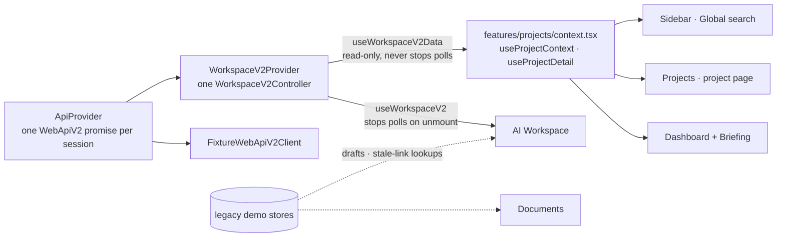

# Unified project context (F3, fixture-only)

> **Status: F3, mock-only.** Dashboard, Projects, the project page, the sidebar, global search and the AI Workspace
> now share ONE project and Copilot-thread identity: Web API v2 test data from the in-browser fixture server
> (`lib/api/v2/mode.ts` → `FixtureWebApiV2Client`). No request leaves the browser, no AI model is called, nothing
> is stored on a server. Task: [#15](https://github.com/Pickle-Pee/smm_ai_helper_web/issues/15) · F1
> [#10](https://github.com/Pickle-Pee/smm_ai_helper_web/pull/10) · F2 [#12](https://github.com/Pickle-Pee/smm_ai_helper_web/issues/12) /
> [#13](https://github.com/Pickle-Pee/smm_ai_helper_web/pull/13) · architecture
> [#6](https://github.com/Pickle-Pee/smm_ai_helper_web/issues/6) · epic
> [smm_ai_helper#158](https://github.com/Pickle-Pee/smm_ai_helper/issues/158).

## 1. The problem F3 removes

Before F3 the app had two data systems with different ids: the legacy mock dataset (`p-…` / `t-…`, Dashboard,
Projects, project page, search) and Web API v2 fixtures (UUIDs, AI Workspace). Picking a brand on the Dashboard and
opening the Workspace produced «проект отсутствует в тестовых данных».

## 2. One source of truth

* **Identity:** the session's `WorkspaceV2Controller` (F2) already loaded organizations → projects → thread
  summaries. F3 makes it the read source for every screen instead of adding a projection of its own.
  `useProjectContext()` is a *view* over the controller state (`byId`, `threadsFor`, request-state markers): it holds
  no copy of projects or threads, so nothing can drift. Threads created in the Workspace appear on Dashboard and the
  project page immediately, because they are the same objects.
* **One transport:** `ApiProvider` memoises the transport promise (`v2.current ??=`), `WorkspaceV2Provider` memoises
  the controller. A test with the real `AppProviders` tree asserts one `FixtureWebApiV2Client` instance across
  Dashboard → project page → Workspace. The only other instances are the isolated, labelled Settings playground
  «Web API v2 · примеры» (F1), which never produces navigable ids (source-policy test).
* **Project page reads:** `controller.loadProject(id)` → `getProject` + `getProjectBrand` (read-only, deduplicated)
  → `ProjectDetailView { status: loading | ready | not_found | error, project, brand, brandError }`. `404` covers
  unknown ids, other organizations' projects and legacy ids alike (tenant 404s are indistinguishable by contract).
* **Presenters:** `presentWorkspaceProject` gained `canEdit` (informational), `presentProjectBrand` maps
  `ProjectBrand` to `BrandContextView` (content + readable provenance, no envelope fields), `PROJECT_ROLE_LABEL`.
* **Navigation never touches requests:** `useWorkspaceV2Data` (used by every non-Workspace screen) starts the
  one-time read but never calls `stopAll`/`closeThread`. Only leaving the Workspace stops *waiting* (F2 behaviour);
  the controller keeps every thread's request state and fence, and reopening a thread reconciles read-only.

## 3. Selected brand (session navigation state)

`ProjectContextProvider` keeps `selectedProjectId` — UI state, not server data:

| Set by | When |
| --- | --- |
| Briefing brand selector | the user picks a brand (first visit: the most recently updated active brand) |
| Project page | the project resolved (`ready`) |
| AI Workspace | the user picks a project for a new conversation, or opens a thread (its project) |

Used by: Briefing (initial value), Dashboard «Copilot-диалоги» filter, sidebar highlight, default project of a new
Workspace conversation. A selected id that no longer resolves shows as «not selected» / a Workspace notice — another
project is never substituted.

## 4. Navigation and deep links

| From | To | Carries |
| --- | --- | --- |
| Dashboard tile, Projects card/table, sidebar, search | `/projects/<project_id>` | fixture project id |
| Project page «Открыть в AI Workspace» | `/workspace?new=1&project=<id>` | project id (no draft, nothing sent) |
| Project page «Быстрый старт» | same URL + draft | text, project, scenario, origin |
| Briefing «Открыть в AI Workspace» | `/workspace?new=1&project=<id>` + draft | text, project, scenario, origin «Обзор» |
| Project page «Copilot-диалоги», Dashboard «Copilot-диалоги», search | `/workspace?thread=<thread_id>` | fixture thread id |
| Workspace context panel | `/projects/<project_id>` | project id |

Workspace project resolution for `?new=1`: draft → `?project=` → selected brand → first active project. A draft or
link id that does not resolve leaves the selector **empty** with a notice; sending is blocked until the user picks.
A draft is never sent automatically; the Workspace shows «Черновик из раздела … Ничего не отправлено».

Stale links: `/projects/<unknown|foreign>` → «Проект не найден»; `/projects/p-…` → «Этот проект из старого
демо-набора»; `/workspace?thread=t-…` → «Этот диалог из старого демо-набора»; unknown thread UUID → «Диалог не
найден». Search lists only fixture threads, so it cannot link to a phantom thread.

## 5. Screens

| Screen | Data | Notes |
| --- | --- | --- |
| Dashboard «Бренды в работе» | projects, thread counts, role | no document counts (no project link in the contract) |
| Dashboard «Copilot-диалоги» | thread summaries + local request markers | replaces the legacy «AI-результаты» review queue: the contract has no cross-thread result feed or review status, so none is invented; results open in the thread |
| Dashboard «Недавние документы» | legacy demo | labelled «Отдельный демо-набор», no legacy brand names |
| Briefing | projects + selected brand | viewer projects marked «только просмотр»; summary counts running requests |
| Projects | projects, thread counts, role | «Новый проект» disabled with an explanation; `/projects?create=1` explains instead of opening a form |
| Project page | `getProject` + `getProjectBrand`, the project's threads | read-only context incl. geography and provenance; «Редактировать контекст» disabled; Documents tab explains that files are not linked yet |
| Sidebar | projects | marks the selected brand |
| Global search | projects, thread titles; legacy documents | documents grouped as «Документы (демо-набор)» |
| AI Workspace | unchanged F2 controller | context panel links to the project page; no legacy documents in it |

## 6. Create / edit decision

`WebApiV2` (F1 interface) has no project or brand writes; the proposed `createProject` / `updateProjectBrand` exist
only in the contract YAML. F3 therefore **disables** creation and editing (layout kept, reason announced via
`aria-describedby`) rather than keeping a local sandbox: a locally created brand would look like a server project
while the Workspace could never find it. The legacy local create/edit (`ProjectFormDialog`, store mutations) was
removed. The contract is not extended here.

## 7. Legacy stores that remain

| Store | Still used for | Remove when |
| --- | --- | --- |
| `LegacyDemoProjectsProvider` / `useLegacyDemoProjects` (`features/projects/store.tsx`, read-only) | Documents' demo brands; explaining stale `p-…` links and drafts | Documents move to a real API |
| `WorkspaceProvider` (`features/workspace/store.tsx`) | draft handoff (`prepareDraft`); recognising stale `t-…` links | drafts move to a dedicated handoff module / legacy links expire |
| `DocumentsProvider` | Document Workspace demo | Storage/Auth Foundation + documents API |

Settings «Сбросить демо-данные» resets only the legacy demo dataset; Web API v2 test data resets on page reload.

## 8. Guarantees kept from F1/F2

`RequestCoordinator` is the only path that can start AI work; no automatic retries; `404` on recovery is not proof
that nothing ran; unresolved requests keep their thread fenced; navigation never mints a `request_key` or resets
request state (integration test: leave a running workflow, return, same key, one POST); `NEEDS_INPUT` keeps the key
and increments the revision; `mode.ts` stays fixture-only; no `/api/v2` calls; every fixture answer is labelled
«Пример из тестовых данных — AI не подключён»; Preview Banner and `noindex` unchanged.

## 9. Tests

| Area | File |
| --- | --- |
| Same project ids on Dashboard / sidebar / Projects / Workspace; one transport and one controller start; Dashboard → project page → Workspace; project page threads; Briefing draft handoff (text, brand, scenario, origin, no auto-send, then one confirmed request in that project); brand kept across sections; active request survives navigation (same key, one POST); unknown / foreign / legacy ids; missing project in a Workspace link; stale thread links and search; viewer read-only; project isolation; no create/edit, no form, Documents not linked; no network on a full walk; real `AppProviders` share one fixture instance | `features/projects/unified-context.test.tsx` |
| `loadProject` (ready, 404, brand failure, dedupe, viewer), `presentProjectBrand` | `features/workspace/v2/project-reads.test.ts` |
| Screens never read legacy projects/threads; one fixture transport; data hook never stops polls; no local project writes | `features/projects/source-policy.test.ts` |

## 10. Still open before a real backend

* Project/brand writes (`createProject`, `updateProjectBrand`, Telegram import) need an approved `WebApiV2`
  extension and backend B3–B4; until then create/edit stay disabled.
* Documents, cross-thread result feeds and review statuses have no contract yet (DOC epics).
* Prerequisites for HTTP stay as listed in [api-client.md §9](api-client.md): in particular
  [#14](https://github.com/Pickle-Pee/smm_ai_helper_web/issues/14) (unsafe retention cleanup of damaged IndexedDB
  rows) **must be fixed before** real HTTP and the durable pending store are enabled, and
  [#11](https://github.com/Pickle-Pee/smm_ai_helper_web/issues/11) (edge `413` documentation) before the edge
  rollout. Neither is changed in F3.
* Pagination: the controller reads the first page of projects/threads (fixtures return `next_cursor: null`);
  keyset pagination for large organizations is needed with real data.
