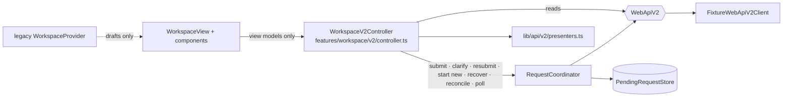

# AI Workspace on Web API v2 (F2, fixture-only)

> **Status: F2, mock-only.** `/workspace` now runs on the typed Web API v2 layer from F1, but the only transport is
> still the in-browser fixture server (`lib/api/v2/mode.ts` → `FixtureWebApiV2Client`). No request leaves the
> browser, no AI model is called, nothing is stored on a server. Every simulated answer is labelled
> «Пример из тестовых данных — AI не подключён». Task: [#12](https://github.com/Pickle-Pee/smm_ai_helper_web/issues/12) ·
> F1 [#9](https://github.com/Pickle-Pee/smm_ai_helper_web/issues/9) · architecture
> [#6](https://github.com/Pickle-Pee/smm_ai_helper_web/issues/6) · contract `docs/api/web-api-v2.openapi.yaml`.

## 1. What moved to Web API v2

| Workspace part | Before (F1) | Now (F2) |
| --- | --- | --- |
| Projects in the Workspace header / context panel | legacy mock dataset | `listOrganizations` → `listProjects` (fixture), `presentWorkspaceProject` |
| Thread history list | legacy `useWorkspace().threads` | `listThreads` per project, `presentThreadSummary` (no messages) |
| Opening a thread | local messages | `getThread` + **lazy** `listThreadMessages` on open, `presentThreadMessage` |
| New conversation | local reducer `createThread` | `createThread(kind: "copilot", Idempotency-Key)` |
| Sending | local "saved in this tab" message | `RequestCoordinator.submitNew` |
| Clarification | — | `RequestCoordinator.answerClarification` (same key, revision + 1) |
| Results | legacy `ResultCard` (mock `StructuredResult`) | `WorkspaceResultCard` ← `presentSnapshot` / `presentAssistantMessage` (`presentation.payload` only) |
| Reopen a stored snapshot | — | `getMessageResult` → result view or `format_unsupported` / `corrupted` / `unreadable` / `not_ready` / `gone` |
| Status / progress | — | `RequestStatus` ← `presentExecution` (server state verbatim) |

Since F3 ([project-context.md](project-context.md)) Dashboard, Briefing, Projects, the project page, the sidebar and
global search read projects and threads from the SAME controller. Still on the legacy local store
(`features/workspace/store.tsx`, `WorkspaceProvider`): draft handoff (`prepareDraft`) and recognising stale legacy
thread links; Documents and its demo brands stay on the legacy dataset. The legacy store can no longer create threads
or messages. The Settings playground «Web API v2 · примеры» (F1) is unchanged.

## 2. Architecture

* `WorkspaceV2Controller` is framework-agnostic (`subscribe` / `getSnapshot`, used with `useSyncExternalStore`) and
  lives in `WorkspaceV2Provider` for the app session, so state survives page navigation but not a reload.
* DTOs stay private to the controller; React gets view models (`WorkspaceProjectView`, `ThreadSummaryView`,
  `ThreadMessageView`, `ExecutionView`, `ResultView`).
* A source-policy test pins that nothing under `features/workspace/` (except the F1 playground) calls
  `submitMessage` / `getRequestByKey` directly and that no component constructs a transport or coordinator.

### Per-thread request state

`ThreadRequestView.phase`: `idle` → `submitting` → `waiting` (server `pending`/`running`, polling) → `settled`
(durable server state; `execution.status` says which) · `unknown` (POST outcome not established, thread fenced) ·
`rejected` (server rejected before admission: 409/403/422/429) · `refused` (local guard, storage failure, no
permission — nothing sent). The composer is disabled with an announced reason whenever a normal new request is not
allowed (viewer, in flight, unknown, `ambiguous`, `expired`).

### Polling

Only the open thread polls, at most one loop per thread, with the server's `poll_after_ms`. Switching threads,
leaving the page (unmount → `stopAll`) or «Перестать ждать» aborts the loop: waiting stops, the server request is
not cancelled, repeated or reclassified. `running_overdue` is shown as a hint, never turned into `ambiguous`.

## 3. Request recovery (no duplicate generation)

1. A new request gets a fresh key; the frozen payload is stored **before** the POST (`flush()` for durable stores —
   fail closed if it cannot be written).
2. 503 / network / timeout → read-only `getRequestByKey`; never a second POST.
3. Recovery `404` → `unknown / no_visible_record`: «не доказывает, что генерация не запускалась»; nothing is resent.
4. Every path that can admit AI work (new request, clarification, same-key resend, acknowledged restart) first
   re-reads the pending store; if that read fails, `PendingStoreError("read_failed")` is raised **before** a key is
   minted or anything is sent (a stale cache could miss another tab's unresolved request). Read-only reconciliation
   with a failed re-read reports the store as unavailable and keeps the thread blocked until «Проверить статус»
   re-reads it successfully.
5. While a thread has an unresolved record, normal sending is refused (`unresolved_request`). «Проверить статус» only
   reads. Opening a thread reconciles read-only: `Thread.in_flight` → follow; latest request → `inspect`; other local
   records → `recover`.
6. Same-key resend only on the server's `next_action: "resubmit_same_key"` («Отправить тот же запрос»).
7. A new key only through «Начать новый запрос…»: a dialog with the regeneration warning and a required checkbox,
   then `startNewRequest(..., { acknowledgeMayRegenerate: true })`. The original stored payload is reused.
   * Same thread (earlier outcome unknown, `ambiguous`, `expired`, failed): the earlier unresolved keys of that thread
     stay in the store as `superseded` (recoverable by key).
   * Earlier request still `pending` / `running` (overdue): one in-flight request per thread is a server rule, so the
     new request goes to a **new thread** of the same project with its own key. The earlier request is **not**
     superseded, cancelled or deleted — its thread keeps the record (still fencing) and stays independently
     recoverable; the new thread only shows a link back to it.

## 4. Pending request storage

| Selection (`selectPendingRequestStore`) | When | Guarantees |
| --- | --- | --- |
| `transient` (memory) | no verified principal — **always in the public preview** | per tab; reload loses it, exactly like the fixture server state. The UI says data resets on reload. |
| `durable` (`IndexedDbPendingRequestStore`) | verified principal (future HTTP mode) | see below |
| `unavailable` (`FailClosedPendingRequestStore`) | principal, but IndexedDB cannot be opened | `flush()` always rejects → no POST without a stored record; recovery reads still work |

`IndexedDbPendingRequestStore` (`lib/api/v2/pending-store-idb.ts`):

* rows keyed by `[scope, requestKey]`, scope = `u:<userId>|o:<orgId>`; each row also keeps `threadId`, `projectId`,
  status (`sending` / `accepted` / `unresolved` / `rejected` / `superseded`), `supersededBy`, timestamps;
* write-behind queue; `flush()` resolves only when committed and rejects after any failed write (store stays
  poisoned until a successful `refresh()`);
* `refresh()` before every preflight reloads rows of other tabs; `BroadcastChannel` nudges other tabs after commits;
  optional Web Locks per thread (`webLocksThreadLock`); the server's `409 thread_busy` stays authoritative;
* versioned: `DB_VERSION` owns the layout (migrations in `upgrade()`), rows carry `schemaVersion`; an undecodable
  row (unknown version, damaged payload) always fences its thread as `unresolved`, whatever status it claims (even
  `rejected` / `superseded`), and its payload is never resent (`payloadUnavailable`, preserved on rewrite);
* retention: `rejected` / `superseded` rows older than 30 days are deleted; fencing rows are kept until resolved;
* account switch: `purgeOtherPrincipals()`; logout: `clearPrincipalRecords(indexedDB, userId)`.

It is **not** a history store and does not replace server-side persistence. Payloads are plaintext in the origin's
IndexedDB (encryption at rest is deferred). It is tested with `fake-indexeddb` and an injected identity only; the app
does not open IndexedDB in F2.

## 5. Project ids and navigation

The Workspace uses **only** fixture project/thread ids — since F3 the same ids every other screen uses. Legacy demo
ids (`p-…`, `t-…`) are never mapped:

* a new conversation takes its project from, in order: a handed-over draft, `?new=1&project=<id>`, the session's
  selected brand, else the first active project. A draft/link id that does not resolve (legacy, foreign, unknown)
  leaves the project selector **empty** with a notice; nothing can be sent until the user picks a project;
* a draft keeps its text, scenario and origin («Черновик из раздела …»); it is never sent automatically;
* `/workspace?thread=t-…` (old links) shows «Этот диалог из старого демо-набора»;
* unknown fixture ids show «Диалог не найден».

## 6. Preview controls

«Тестовый ответ сервера» above the composer chooses how the fixture server answers the next new request in that
thread (`setThreadScenario`): direct, module, workflow, needs-input, failed, blocked, ambiguous, overdue, unsupported,
503 after/before admission, quota. Scenario cards preselect a matching answer. Seeded threads demonstrate reopen,
`expired`, a fresh `pending` (same-key resubmit), `running_overdue` and `format_unsupported`.

## 7. Limits until HTTP mode

No real sessions, so no durable pending store in the app; fixture data and unconfirmed requests reset on reload; no
thread deletion (not in `WebApiV2`); no web chat (`kind: "chat"` disabled); Documents, teams and plans stay mock;
Documents still show the legacy dataset; the HTTP switch remains a separate reviewed change
(`docs/api-client.md` §9).
